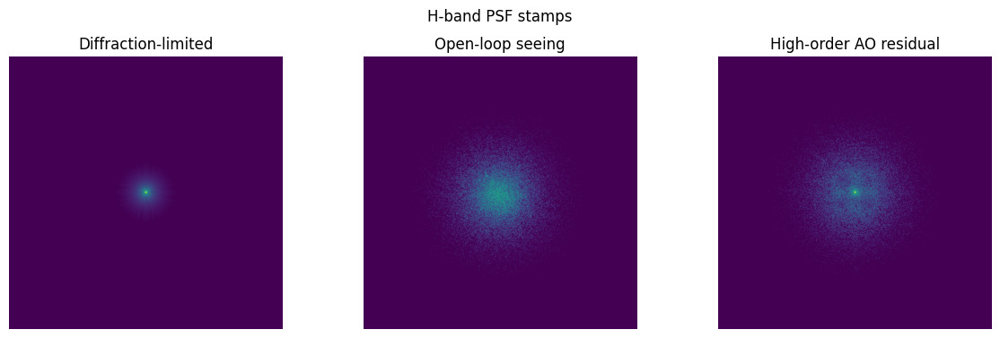
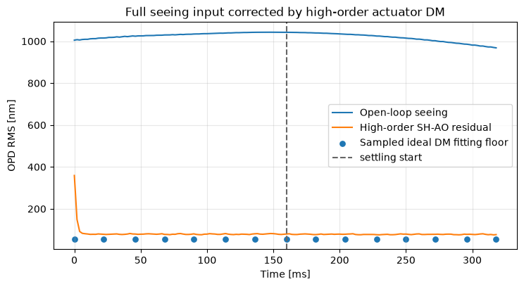
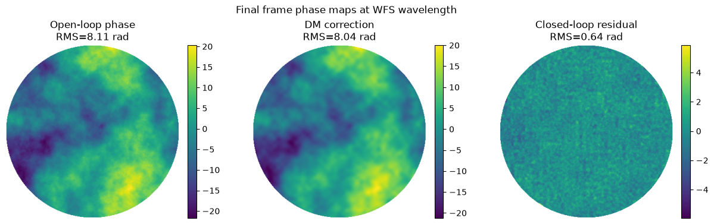
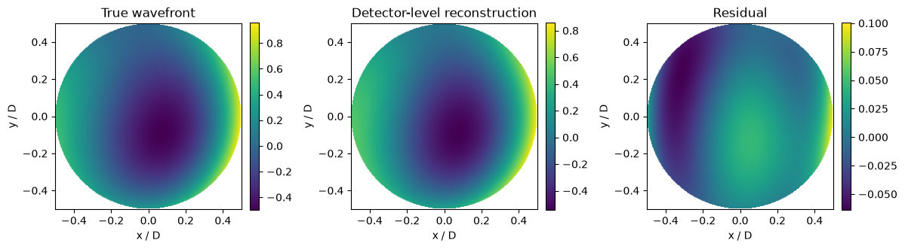
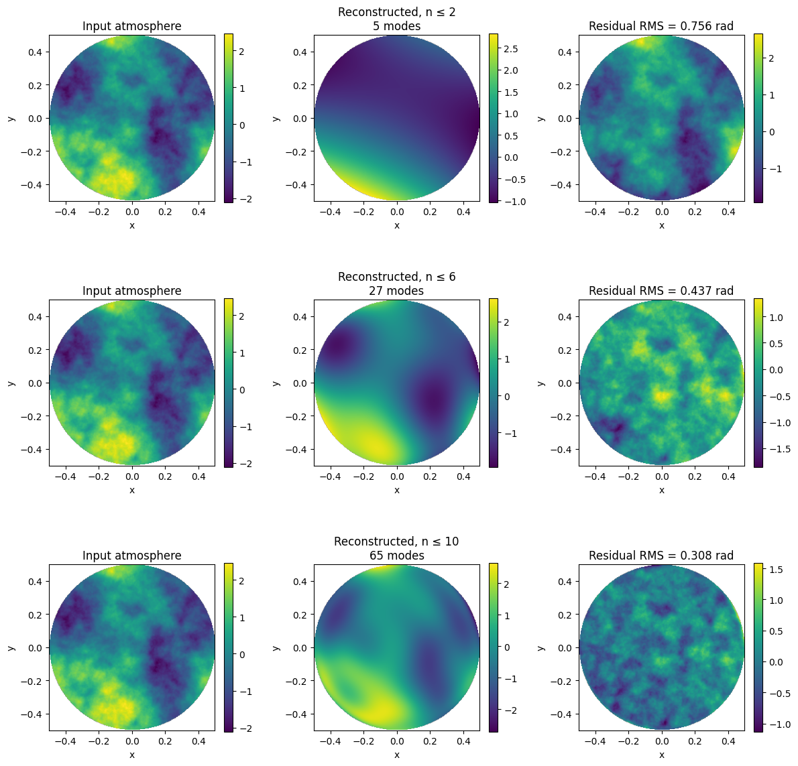
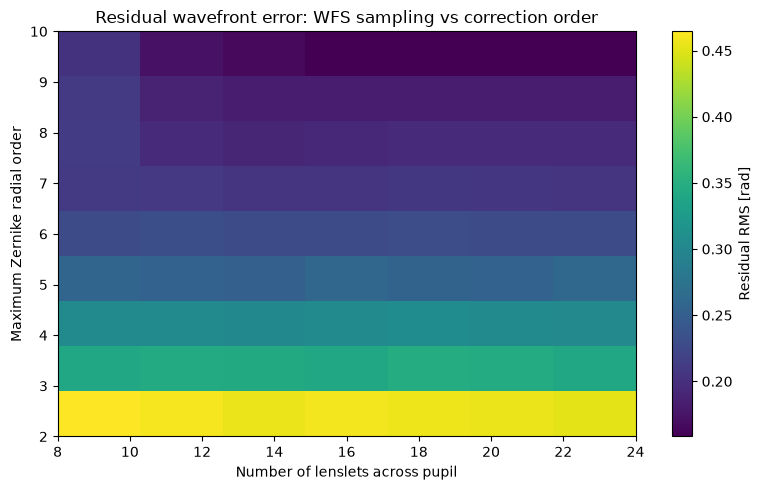
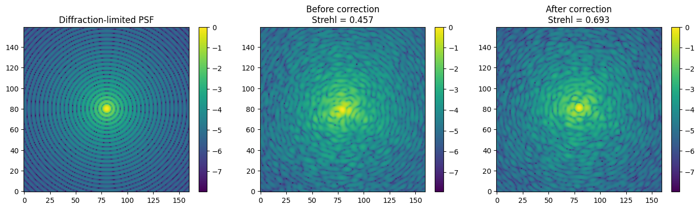
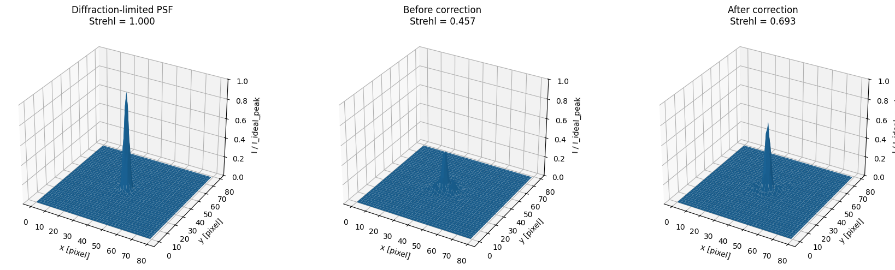

# Shack-Hartmann and Adaptive Optics Simulation Portfolio

A compact Python portfolio project for adaptive optics (AO) and wavefront sensing (WFS), focused on Shack-Hartmann wavefront sensing, detector-level centroiding, modal reconstruction, regularization, closed-loop correction, PSF/Strehl diagnostics, and a simplified pyramid-WFS extension.

This project was developed as a transparent study simulator for astronomical instrumentation. It is not intended to be a calibrated observatory grade AO package. The emphasis is on making the full measurement and reconstruction chain explicit:

```text
pupil-plane phase error
→ wavefront-sensor measurement
→ response/interaction matrix
→ modal reconstruction and regularization
→ deformable mirror or modal correction
→ residual wavefront
→ PSF, Strehl, and image quality diagnostics
```

## Project scope

The project studies how wavefront errors are measured, reconstructed, regularized, and corrected in a compact simulation environment. The main technical focus is the detector-level Shack-Hartmann branch, where local wavefront slopes are replaced by simulated lenslet spots, detector noise, centroiding, reference subtraction, and centroid-shift response matrices.

The project also includes a simplified Fourier-optics pyramid wavefront sensor (PWFS) branch. The PWFS part is included as an advanced extension: it demonstrates detector images, four re-imaged pupil intensities, normalized `Sx/Sy` signal maps, modal interaction matrices, and reconstruction diagnostics, but it is not yet a full validated PWFS AO control simulator.

## Main features

* Circular pupil grids and Zernike modal wavefronts
* Atmospheric-like phase screens with Kolmogorov/von Karman style spectral structure
* Geometric Shack-Hartmann WFS slope sensing
* Detector-level Shack-Hartmann WFS simulation:

  * lenslet diffraction spots
  * finite detector windows
  * photon noise, read noise, and background
  * centroiding and reference-subtracted centroid shifts
  * detector-level response matrices
* Modal least-squares reconstruction
* Singular value diagnostics and TSVD/`rcond` regularization
* Sampling density versus correction-order studies
* Simplified Gaussian-influence-function deformable mirror
* Geometric and detector-level closed-loop AO demonstrations
* Loop gain and loop delay diagnostics
* PSF, Strehl ratio, radial-profile, and Marechal-style diagnostics
* Simplified Fourier optics PWFS forward model:

  * pyramid-like phase mask
  * four re-imaged pupil images
  * modulation points
  * noisy detector measurement
  * modal PWFS calibration

## Representative figures

### High-order AO correction: NIR PSF sharpening



### Closed-loop residual OPD RMS



### Wavefront correction: input phase, DM correction, and residual



### Detector-level Shack-Hartmann reconstruction



### Modal atmospheric reconstruction



### Sampling density versus correction order



### PSF before and after correction



### 3D PSF comparison



## Repository structure

```text
.
├── src/
│   ├── zernike.py
│   ├── phase_screen.py
│   ├── reconstruction.py
│   ├── shwfs_detector.py
│   ├── ao_closed_loop.py
│   ├── psf_tools.py
│   └── pwfs_forward.py
│
├── notebooks/
│   ├── 01_test_sh_wfs.ipynb
│   ├── 02_sh_wfs_experiment.ipynb
│   ├── 03_zernike_mode_scan.ipynb
│   ├── 04_sampling_vs_mode_order_heatmap.ipynb
│   ├── 05_tsvd_regularization.ipynb
│   ├── 06_detector_level_shwfs.ipynb
│   ├── 07_closed_loop_ao.ipynb
│   ├── 07_detector_level_closed_loop_ao.ipynb
│   └── 08_pwfs_detector_level_atmospheric_turbulence.ipynb
│   
│
├── figures/
│   ├── detector_level_reconstruction.png
│   ├── modal_atmosphere_reconstruction.png
│   ├── sampling_vs_correction_order.png
│   ├── psf_before_after_correction.png
│   └── psf_3d_before_after.png
│
├── requirements.txt
├── README.md
└── LICENSE
```

## Code architecture

| Module              | Main role                                                                                                                                                       |
| ------------------- | --------------------------------------------------------------------------------------------------------------------------------------------------------------- |
| `zernike.py`        | Pupil grid generation, named low-order Zernike-like modes, general real Zernike modes, modal synthesis, piston removal, and RMS calculation.                    |
| `phase_screen.py`   | Atmospheric-like phase screens, seeing / `r0` utilities, wavelength scaling, phase-to-OPD conversion, OPD-to-phase conversion, and frozen-flow shifting.        |
| `reconstruction.py` | Geometric SH-WFS subapertures, local slope measurement, response matrices, least-squares modal reconstruction, and residual metrics.                            |
| `shwfs_detector.py` | Detector-level SH-WFS simulation: lenslet diffraction spots, detector noise, centroiding, reference centroids, centroid shifts, and detector response matrices. |
| `ao_closed_loop.py` | Gaussian DM influence functions, DM-to-WFS response matrices, command updates, geometric closed-loop AO, detector-level closed-loop AO, and loop diagnostics.   |
| `psf_tools.py`      | FFT-based PSF calculation, Strehl ratio, radial profiles, Marechal approximation, and wavelength-dependent phase diagnostics.                                   |
| `pwfs_forward.py`   | Simplified Fourier-optics PWFS model, pyramid phase mask, pupil-image extraction, modulation, detector noise, `Sx/Sy` maps, and PWFS interaction matrices.      |

## Notebook sequence

| Notebook                                                       | Purpose                                                                                                                                                                                                      |
| -------------------------------------------------------------- | ------------------------------------------------------------------------------------------------------------------------------------------------------------------------------------------------------------ |
| `01_test_sh_wfs.ipynb`                                         | Initial SH-WFS sanity tests for deterministic and atmospheric-like phase inputs. Checks slope-field sign convention, modal reconstruction, residual phase, and Strehl improvement.                           |
| `02_sh_wfs_experiment.ipynb`                                   | Broader baseline SH-WFS experiment with fixed and random wavefronts, detector spot checks, centroid validity, calibration amplitude tests, photon-noise sensitivity, and PSF diagnostics.                    |
| `03_zernike_mode_scan.ipynb`                                   | Studies how reconstruction quality changes with maximum Zernike order and controlled mode number. Includes residual RMS, condition number, rank, singular spectra, and Strehl diagnostics.                   |
| `04_sampling_vs_mode_order_heatmap.ipynb`                      | Maps the trade-off between lenslet sampling density and correction order. Includes noise extensions to show when higher-order reconstruction becomes counterproductive.                                      |
| `05_tsvd_regularization.ipynb`                                 | Demonstrates TSVD regularization in an intentionally ill-conditioned reconstruction problem. Connects singular-value cutoffs to residual wavefront error and Strehl.                                         |
| `06_detector_level_shwfs.ipynb`                                | Clean detector-level SH-WFS pipeline: diffraction-limited lenslet spots, finite detector windows, noisy centroiding, response-matrix calibration, coefficient reconstruction, and centroid-noise scans.      |
| `07_closed_loop_ao.ipynb`                                      | Geometric closed-loop AO baseline with Gaussian DM influence functions, ideal SH-WFS slopes, integrator control, RMS tracking, and Strehl diagnostics.                                                       |
| `07_detector_level_closed_loop_ao.ipynb`                       | Detector-level closed-loop AO using centroid-shift measurements instead of ideal slopes. Includes detector response matrices, loop gain, loop delay, command leak, residual RMS, and PSF/Strehl diagnostics. |
| `08_pwfs_detector_level_atmospheric_turbulence.ipynb` | Simplified detector-level PWFS extension with Fourier propagation, pyramid-like phase mask, four re-imaged pupils, detector noise, `Sx/Sy` maps, modal calibration, reconstruction, and PSF diagnostics.     |

## Installation

Clone the repository:

```bash
git clone https://github.com/xhvoid/Shack-Hartmann-AO-Simulation.git
cd Shack-Hartmann-AO-Simulation
```

Install the required packages:

```bash
pip install -r requirements.txt
```

The project is intentionally lightweight. The core dependencies are mainly:

```text
numpy
matplotlib
jupyter
ipykernel
```

Depending on the exact notebook version, some notebooks may also use standard scientific-Python utilities such as `scipy`.

## Running the notebooks

Start Jupyter from the repository root:

```bash
jupyter notebook
```

Recommended reading order:

```text
01 → 02 → 03 → 04 → 05 → 06 → 07 → 07b → 08
```

For a short review, start with:

```text
06_detector_level_shwfs.ipynb
07_detector_level_closed_loop_ao.ipynb
08_pwfs_detector_level_atmospheric_turbulence.ipynb
```

## Technical highlights

### 1. Detector-level SH-WFS measurement chain

The detector-level Shack-Hartmann model follows the measurement process more explicitly than a geometric slope model:

```text
local pupil phase
→ lenslet focal-plane spot
→ finite detector window
→ photon / read / background noise
→ centroid measurement
→ reference-subtracted centroid shift
→ calibrated response matrix
→ modal reconstruction
```

This is useful because real Shack-Hartmann sensors do not measure continuous slopes directly. They measure spot images on detector pixels. Centroiding error, finite sampling, photon statistics, read noise, spot clipping, and thresholding all enter before the reconstruction step.

### 2. Response-matrix conditioning and TSVD regularization

The reconstruction problem is treated as a linear inverse problem. Each WFS model produces an interaction matrix whose singular values determine which modal combinations are strongly or weakly sensed.

The TSVD notebooks show that keeping all singular directions is not always optimal. Weak singular directions can amplify noise, while overly aggressive truncation removes useful modal information. The useful cutoff is therefore a system-level trade-off between fitting error, noise amplification, and image quality.

### 3. Closed-loop AO correction

The closed-loop branch uses a simplified deformable mirror with Gaussian influence functions and an integrator controller. The simulation tracks residual phase RMS, Strehl ratio, and command evolution over loop iterations.

The detector-level closed-loop experiment is deliberately simplified, but it no longer uses ideal analytic slopes. The loop is driven by centroid-shift measurements from simulated lenslet spots.

### 4. PWFS extension

The pyramid-WFS branch uses a compact Fourier-optics model. The pupil field is propagated to the focal plane, multiplied by a pyramid-like phase mask, and propagated back to form four re-imaged pupil intensities. Normalized `Sx/Sy` maps are then used as the PWFS measurement vector.

This branch should be read as an exploratory extension. It demonstrates the PWFS measurement logic and modal calibration, but it does not yet include a fully validated PWFS modulation, control, and detector-readout model.


## Limitations

The current implementation intentionally keeps several assumptions simple:

* The atmosphere is represented by compact Kolmogorov/von Karman-like phase screens.
* Some atmospheric screens are RMS-normalized for controlled tests.
* The deformable mirror uses idealized Gaussian influence functions.
* The detector models are simplified.
* The SH-WFS branch is more mature than the PWFS branch.
* The PWFS branch is a compact Fourier-optics demonstrator, not a fully validated PWFS control simulator.
* The closed-loop models are simplified and do not include full temporal bandwidth, latency, calibration drift, non-common-path aberrations, real DM influence measurements, or full detector characterization.
* The simulations are not calibrated to a specific telescope, instrument, guide-star configuration, or observatory AO system.

These limitations are intentional: the project is designed to make the modelling chain inspectable and educational rather than to hide assumptions inside a black-box simulator.


## Author

Xu Han
MSc Astrophysics, LMU Munich
MSc Photonics student, Hochschule München

Research interests: adaptive optics, astronomical instrumentation, detector-level wavefront sensing, PSF modelling, instrument-performance prediction, and astrophotonics.

## License

This project is released under the MIT License.
