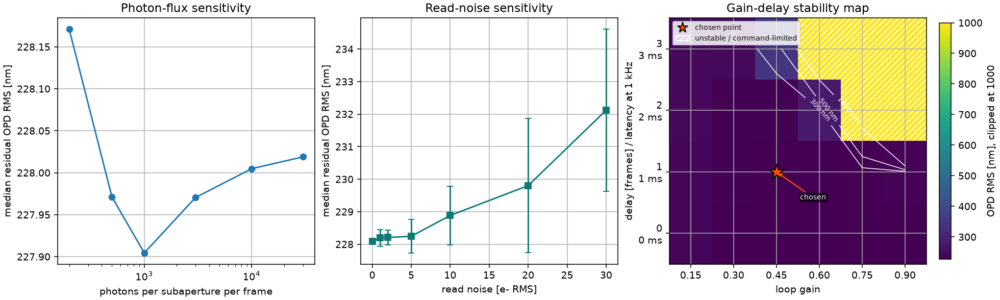
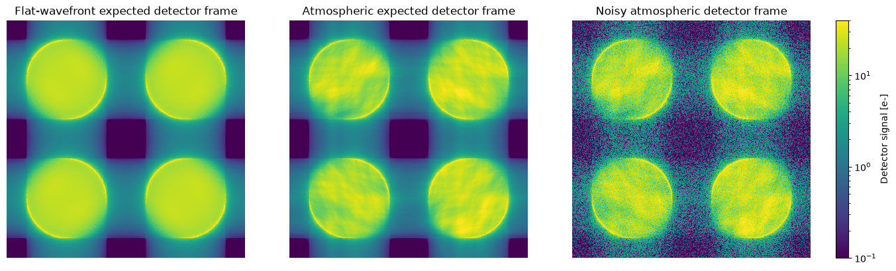

# Shack-Hartmann Wavefront Sensing and Adaptive Optics Simulations

[](https://github.com/xhvoid/Shack-Hartmann-AO-Simulation/actions/workflows/ci.yml)

This repository contains a sequence of Python simulations for Shack-Hartmann wavefront sensing, wavefront reconstruction, simplified closed-loop adaptive optics, and PSF-based performance diagnostics.

I built it as a compact, inspectable AO modelling project rather than a calibrated observatory simulator. The emphasis is on understanding the numerical chain from pupil-plane phase errors to WFS measurements, reconstruction, correction, residual wavefronts, and science-wavelength PSFs:

```text
pupil-plane phase error
→ wavefront-sensor measurement
→ response / interaction matrix
→ regularized reconstruction
→ deformable-mirror or modal correction
→ residual wavefront
→ PSF, Strehl, FWHM, and encircled-energy diagnostics
```

## Project scope

The repository focuses on five connected parts of an AO simulation chain:

* SH-WFS measurement: geometric slopes and detector-level lenslet spot centroiding.
* Reconstruction: modal response matrices, singular-value diagnostics, and TSVD regularization.
* Closed-loop correction: simplified DM influence functions, integrator control, gain tuning, and delay tests.
* Science diagnostics: residual OPD RMS, Strehl ratio, FWHM, EE50/EE80, and J/H/K PSF comparisons.
* Extensions: simplified PWFS forward modelling and compact noise / latency / gain-stability scans.

Notebook 09 is the closest one to an instrument-performance calculation. It moves from low-order modal correction to a high-order actuator-space SH-AO demonstration with 48 × 48 WFS sampling, a 49 × 49 nominal actuator grid, TSVD command reconstruction, and J/H/K PSF diagnostics. Notebook 10 then asks a more engineering-style question: what happens when measurement noise, loop delay, and gain tuning are no longer ignored?

## Quick review path

For a short technical review, I would start with:

1. `06_detector_level_shwfs.ipynb` — detector-level SH-WFS centroiding and response calibration.
2. `09_ao_psf_instrument_performance_high_order_ao.ipynb` — high-order actuator-space SH-AO and NIR PSF diagnostics.
3. `10_noise_latency_gain_stability.ipynb` — noise, latency, and gain-stability trade-offs.

The earlier notebooks document the build-up from low-order modal reconstruction to detector-level and closed-loop models.

## Representative figures

### High-order AO correction: NIR PSF sharpening

Notebook 09 compares three PSF cases: diffraction-limited, open-loop atmospheric, and AO-corrected.


### Closed-loop residual OPD RMS

The high-order loop is run on a frozen-flow atmospheric sequence. I use the post-settling residual OPD RMS as the main wavefront-error diagnostic.


### Wavefront correction maps

The wavefront maps show the open-loop atmospheric phase, the DM correction, and the final closed-loop residual. This illustrates that the controller reconstructs actuator commands rather than only fitting low-order Zernike modes.


### Noise, latency, and loop-gain trade-offs

Notebook 10 scans photon flux, read noise, loop gain, and frame delay. This is meant to show where a clean AO loop becomes optimistic.



### Simplified PWFS detector images

The PWFS branch is exploratory. It shows detector-plane pupil images and normalized slope-like signal maps, but it is not a validated PWFS control simulator.



### Sampling density versus correction order

This diagnostic tracks how WFS sampling density and controlled modal order affect conditioning and correction quality.


### Detector-level Shack-Hartmann reconstruction

The detector-level SH-WFS notebooks simulate lenslet spots, finite detector windows, noise, centroiding, reference subtraction, and response-matrix reconstruction.


## Repository structure

```text
src/          reusable AO, WFS, reconstruction, PSF, and PWFS utilities
notebooks/    narrative simulations from SH-WFS basics to high-order AO
examples/     lightweight command-line demos used in CI
tests/        numerical sanity checks for the core modules
figures/      selected outputs used in this README and generated examples
.github/      GitHub Actions workflow
```

## Code architecture

I kept the reusable numerical pieces in `src/` so the notebooks stay readable and the core functions can be tested independently. The notebooks are closer to experiment logs; the modules hold the reusable modelling components.

| Module              | Main role                                                                                                                                                       |
| ------------------- | --------------------------------------------------------------------------------------------------------------------------------------------------------------- |
| `zernike.py`        | Pupil grids, Zernike modes, modal synthesis, piston removal, and RMS utilities.                    |
| `phase_screen.py`   | Atmospheric-like phase screens, seeing / `r0` scaling, OPD conversion, and frozen-flow shifts.     |
| `reconstruction.py` | Geometric SH-WFS slopes, response matrices, modal reconstruction, and residual metrics.           |
| `shwfs_detector.py` | Lenslet spots, detector noise, centroiding, reference subtraction, and detector response matrices. |
| `ao_closed_loop.py` | Gaussian DM influence functions, DM-WFS calibration, command updates, and loop diagnostics.       |
| `psf_tools.py`      | FFT PSFs, Strehl ratios, radial profiles, Marechal approximation, and wavelength scaling.         |
| `pwfs_forward.py`   | Simplified Fourier-optics PWFS forward model and `Sx/Sy` signal maps.                            |

## Notebook sequence

| Notebook                                               | Purpose                                                                                                                                                                                                                                                                           |
| ------------------------------------------------------ | --------------------------------------------------------------------------------------------------------------------------------------------------------------------------------------------------------------------------------------------------------------------------------- |
| `01_test_sh_wfs.ipynb`                                 | Initial SH-WFS sanity checks for slopes, modal reconstruction, residuals, and Strehl.                                                                                                                               |
| `02_sh_wfs_experiment.ipynb`                           | Baseline SH-WFS experiments with fixed/random wavefronts, spot checks, photon noise, and PSFs.                                                                                                                      |
| `03_zernike_mode_scan.ipynb`                           | Reconstruction quality versus Zernike order and controlled mode count.                                                                                                                                              |
| `04_sampling_vs_mode_order_heatmap.ipynb`              | WFS sampling density versus correction order and conditioning.                                                                                                                                                      |
| `05_tsvd_regularization.ipynb`                         | TSVD regularization in an intentionally ill-conditioned reconstruction problem.                                                                                                                                      |
| `06_detector_level_shwfs.ipynb`                        | Detector-level SH-WFS centroiding, response calibration, reconstruction, and noise scans.                                                                                                                           |
| `07_closed_loop_ao.ipynb`                              | Geometric closed-loop AO baseline with Gaussian DM influence functions and an integrator controller.                                                                                                                |
| `07_detector_level_closed_loop_ao.ipynb`               | Closed-loop AO driven by detector-level centroid shifts instead of ideal slopes.                                                                                                                                    |
| `08_pwfs_detector_level_atmospheric_turbulence.ipynb`  | Exploratory detector-level PWFS forward model with four pupil images and `Sx/Sy` maps.                                                                                                                             |
| `09_ao_psf_instrument_performance_high_order_ao.ipynb` | High-order actuator-space SH-AO demonstrator with 48 × 48 WFS sampling, 49 × 49 nominal actuator grid, TSVD reconstruction, and J/H/K PSF diagnostics.                                                             |
| `10_noise_latency_gain_stability.ipynb`                | Photon/read-noise, loop-delay, and gain-stability trade-offs.                                                                                                                                                       |

## Installation

Clone the repository:

```bash
git clone https://github.com/xhvoid/Shack-Hartmann-AO-Simulation.git
cd Shack-Hartmann-AO-Simulation
```

Install the required packages:

```bash
python -m pip install -r requirements.txt
```

For development, examples, and tests, install the local project with test and notebook extras:

```bash
python -m pip install -e ".[test,notebooks]"
```

The project is intentionally lightweight. The core dependencies are mainly:

```text
numpy
scipy
matplotlib
pandas
jupyter
ipykernel
```

## Running tests

The repository includes focused unit tests for the numerical core rather than executing notebooks in CI:

```bash
pytest -q
```

The GitHub Actions workflow in `.github/workflows/ci.yml` runs the same test command on Python 3.11 and then executes the two command-line examples.

## Command-line examples

The examples provide quick entry points for checking the code without opening Jupyter:

```bash
python examples/run_shwfs_centroid_demo.py
python examples/run_psf_strehl_demo.py
```

They write lightweight artifacts under `figures/generated/`:

```text
figures/generated/shwfs_centroid_demo.png
figures/generated/shwfs_centroid_demo.csv
figures/generated/psf_strehl_demo.png
figures/generated/psf_strehl_demo.csv
```

## Running the notebooks

Start Jupyter from the repository root:

```bash
jupyter notebook
```

Recommended reading order:

```text
01 → 02 → 03 → 04 → 05 → 06 → 07 → 07b → 08 → 09 → 10
```

For the high-order AO PSF result, start directly with:

```text
09_ao_psf_instrument_performance_high_order_ao.ipynb
```

For noise, latency, and loop-gain trade-offs, start with:

```text
10_noise_latency_gain_stability.ipynb
```

## Reproducibility and validation

I use three lightweight checks rather than trying to execute every notebook in CI:

* Unit tests validate the numerical core: PSF normalization, Strehl sanity checks, phase/OPD conversion, detector centroiding edge cases, phase-screen RMS scaling, and modal reconstruction.
* Command-line examples regenerate small PNG and CSV artifacts from deterministic seeds.
* Notebooks remain the narrative entry points for the broader AO experiments, with notebook 10 explicitly separating clean-model AO performance from noise, latency, and controller-stability stress tests.

## Notes on the main modelling choices

### 1. Detector-level SH-WFS measurement chain

The detector-level Shack-Hartmann model follows the measurement process more explicitly than a geometric slope model:

```text
local pupil phase
→ lenslet focal-plane spot
→ finite detector window
→ photon / read / background noise
→ centroid measurement
→ reference-subtracted centroid shift
→ calibrated response matrix
→ modal reconstruction
```

I included this branch because real Shack-Hartmann sensors do not measure continuous slopes directly. They measure spot images on detector pixels. Centroiding error, finite sampling, photon statistics, read noise, spot clipping, and thresholding all enter before the reconstruction step.

### 2. Response-matrix conditioning and TSVD regularization

The reconstruction problem is treated as a linear inverse problem. Each WFS model produces an interaction matrix whose singular values determine which modal or actuator combinations are strongly or weakly sensed.

The TSVD notebooks show why keeping every singular direction is not always useful. Weak singular directions can amplify noise or unstable command components, while overly aggressive truncation removes controllable modes. The cutoff is a system-level trade-off between fitting error, noise amplification, command conditioning, and image quality.

### 3. Closed-loop AO correction

The closed-loop branch uses a simplified deformable mirror with Gaussian influence functions and an integrator controller. The simulations track residual phase RMS, Strehl ratio, command evolution, and gain stability over loop iterations.

The detector-level closed-loop experiment is deliberately simplified, but it no longer uses ideal analytic slopes. The loop is driven by centroid-shift measurements from simulated lenslet spots.

### 4. High-order actuator-space AO / NIR PSF performance

Notebook 09 takes the earlier low-order examples into a higher-order actuator-space SH-AO loop.

The current high-order run uses:

```text
AO_QUALITY_MODE = "extreme"
N_SUBAP         = 48
N_ACT_ACROSS   = 49
N_PUPIL        = 384
TSVD rcond      = 2e-2
loop gain       = 0.65
```

For the adopted 0.8 arcsec seeing, the SH-WFS subaperture size is close to the Fried parameter at the WFS wavelength. The controller uses an actuator poke matrix and TSVD command reconstruction, then converts residual OPD into J/H/K science PSF metrics.

Representative clean-run results:

```text
open-loop median OPD RMS after settling    ≈ 2914 nm
closed-loop median OPD RMS after settling  ≈ 135 nm
correction factor                          ≈ 22×
```

Approximate NIR Strehl ratios:

```text
J band  ≈ 0.64
H band  ≈ 0.77
K band  ≈ 0.86
```

These values should be read as a clean-model performance demonstration rather than a calibrated prediction for a specific telescope or AO system.

I keep this caveat explicit because the numbers are useful for comparing clean-model cases, but they are not a substitute for a calibrated instrument error budget.

### 5. Noise, latency, and loop-gain stability

Notebook `10_noise_latency_gain_stability.ipynb` adds a compact engineering trade-off layer around the closed-loop AO model. It scans photon flux, read noise, a transparent centroid-noise proxy, loop gain, and frame delay, then reports residual OPD RMS and H-band Marechal Strehl.

This is not a full AO error budget. Its purpose is to make the controller trade-offs visible: noise floors limit the value of high gain, latency narrows the stable gain range, and clean-model Strehl can be optimistic when detector and timing effects are ignored.

### 6. PWFS extension

The pyramid-WFS branch uses a compact Fourier-optics model. The pupil field is propagated to the focal plane, multiplied by a pyramid-like phase mask, and propagated back to form four re-imaged pupil intensities. Normalized `Sx/Sy` maps are then used as the PWFS measurement vector.

This branch should be read as an exploratory extension. It demonstrates the PWFS measurement logic and modal calibration, but it does not yet include a fully validated PWFS modulation, control, and detector-readout model.

## Validation and limitations

The current implementation intentionally keeps several assumptions simple:

* The atmosphere is represented by compact Kolmogorov / von Karman-like phase screens.
* Some atmospheric screens are RMS-normalized for controlled tests.
* The deformable mirror uses idealized Gaussian influence functions.
* The detector models are simplified.
* The SH-WFS branch is more mature than the PWFS branch.
* The PWFS branch is a compact Fourier-optics demonstrator, not a fully validated PWFS control simulator.
* The high-order notebook uses a geometric SH-WFS slope model rather than detector-level spot centroiding.
* The high-order notebook does not include photon noise, read noise, centroiding error, detector nonlinearity, temporal delay, vibration, wind-shake, or a full servo-lag error budget.
* Notebook 10 explores photon/read noise and delay through a simplified proxy model rather than a calibrated detector and real-time-control simulator.
* The high-order notebook does not include multi-layer tomography, LGS cone effect, NCPA, chromaticity, throughput, sky background, or science-camera noise.
* The simulations are not calibrated to a specific telescope, instrument, guide-star configuration, or observatory AO system.

These limitations are intentional: the project is designed to make the modelling chain inspectable and educational rather than to hide assumptions inside a black-box simulator.

## Author

Xu Han
MSc Astrophysics, LMU Munich
MSc Photonics student, Hochschule München

Research interests: adaptive optics, astronomical instrumentation, detector-level wavefront sensing, PSF modelling, instrument-performance prediction, and astrophotonics.

## License

This project is released under the MIT License.
