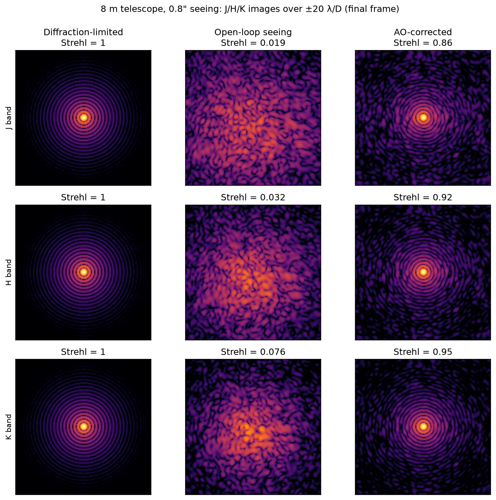
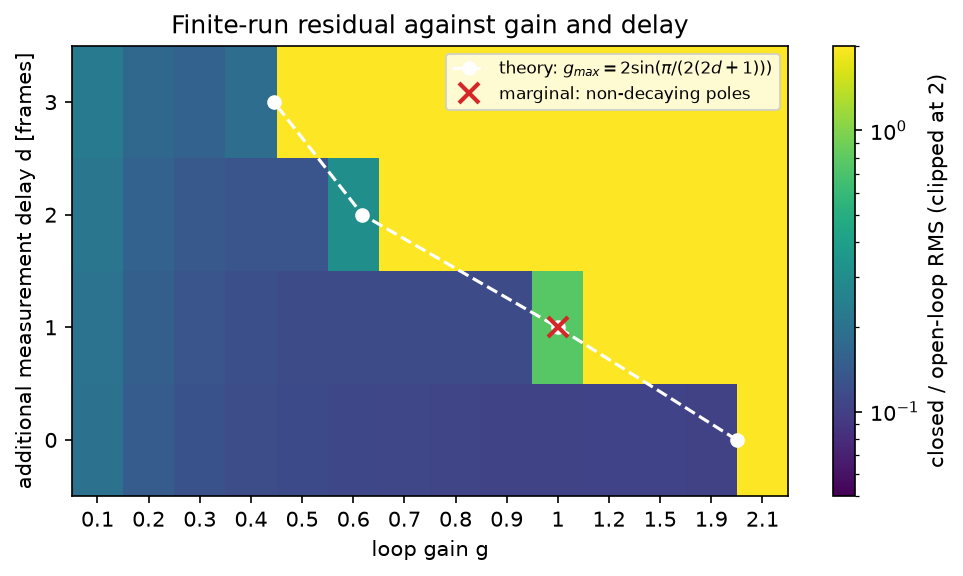
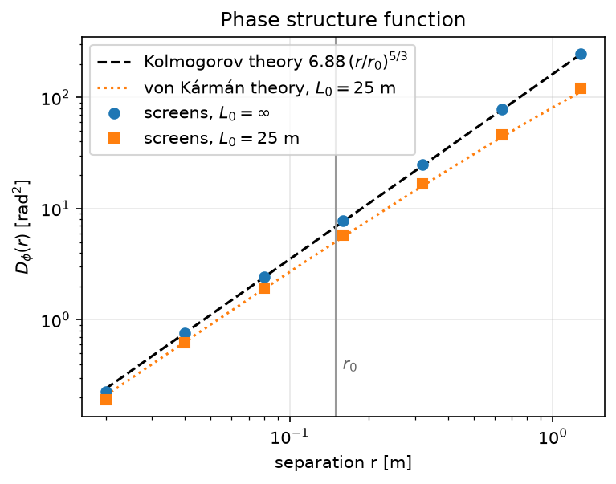
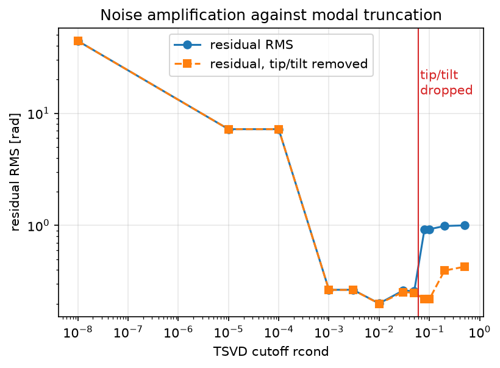
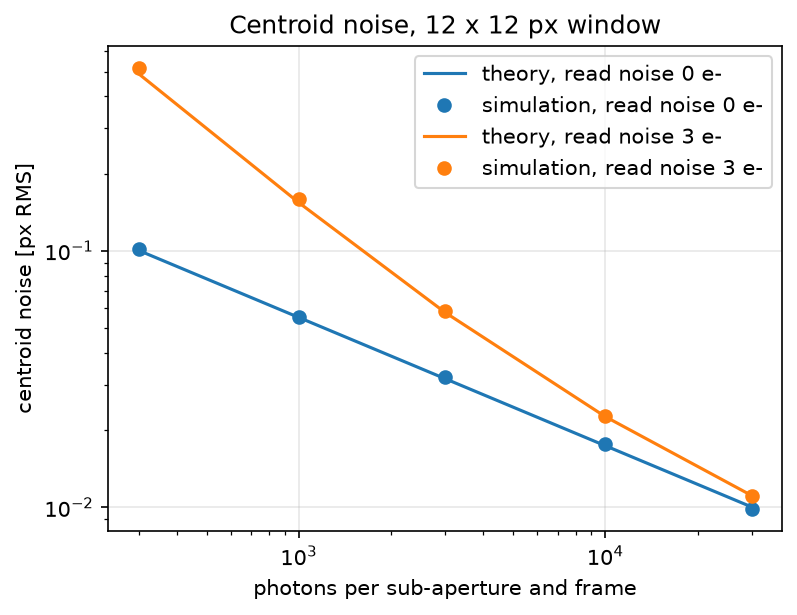
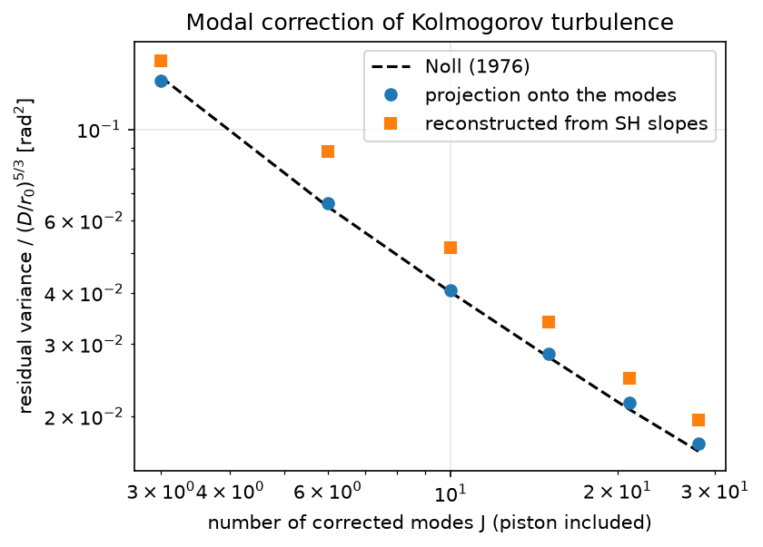
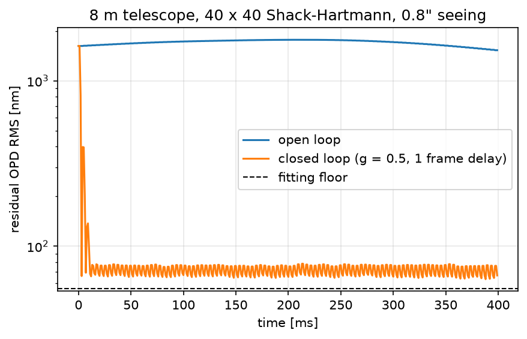
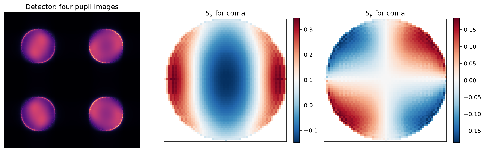

# Adaptive Optics — Basics

[](https://github.com/xhvoid/Adaptive-Optics---Basics/actions/workflows/ci.yml)
[](pyproject.toml)
[](LICENSE)

A Python model of a single-conjugate adaptive-optics system, built from first principles: atmospheric turbulence, Shack–Hartmann wavefront sensing, wavefront reconstruction, closed-loop control and the resulting near-infrared images. Every step is checked against a known analytic result.

I built it to understand AO by implementing each part myself. The code is plain NumPy/SciPy in seven small modules, and seven tutorial notebooks walk through the chain, each ending with a comparison against theory.



*An 8 m telescope in 0.8″ seeing, corrected by a 40 × 40 Shack–Hartmann loop with 1517 actuators at 1 kHz and one frame of delay (noiseless). The wavefront error falls from 1.74 µm to 72 nm, and the image Strehl ratio is 0.88, 0.93 and 0.96 in J, H and K. [Notebook 06](notebooks/06_high_order_psf.ipynb).*

## Results, checked against theory

| Step | Notebook | Check | Result |
| --- | --- | --- | --- |
| Turbulence | [01](notebooks/01_atmosphere.ipynb) | Aperture variance against the von Kármán integral (Noll's 1.0299 and 0.134 in the Kolmogorov limit); structure function against $6.88\,(r/r_0)^{5/3}$ | Variance 36.2 ± 1.9 against 36.9 rad²; structure functions within 8% |
| Shack–Hartmann sensing | [02](notebooks/02_shack_hartmann.ipynb) | Exact slopes of a tilt; residual after correcting J Zernike modes against Noll (1976) | Tilt exact to 1e-15; projection within 4% of Noll for J = 3–28, slope-based reconstruction 12–34% above it (aliasing) |
| Reconstruction | [03](notebooks/03_reconstruction_tsvd.ipynb) | Noise propagation $\sigma_s^2 \sum 1/\sigma_i^2$ through a TSVD reconstructor | Within 4% of 2000 simulated noise draws |
| Detector | [04](notebooks/04_detector_centroiding.ipynb) | Spot shift from the Fourier shift theorem; photon- and read-noise centroid error | Shift within 1–5%; noise within 2% (photon) and 5% (read noise) |
| Closed loop | [05](notebooks/05_closed_loop.ipynb) | Fitting floor $\kappa\,(d/r_0)^{5/3}$; integrator stability limit $2\sin(\pi/(2(2d+1)))$ for $d$ frames of delay | $\kappa$ = 0.23; largest stable gains 1.9, 1.0, 0.6, 0.4 for $d$ = 0–3 against limits of 2, 1, 0.62, 0.45 |
| High-order AO | [06](notebooks/06_high_order_psf.ipynb) | Fitting floor; image Strehl against Maréchal $e^{-\sigma^2}$ | $\kappa$ = 0.22; Strehl within 0.003 of Maréchal in J, H and K |
| Pyramid sensor (exploratory) | [07](notebooks/07_pyramid_sensor.ipynb) | Modulated tilt response against $\tfrac{2}{\pi}\arcsin(t/r)$ | Converges to it as modulation grows (largest difference 0.09 at 2 λ/D, 0.015 at 16 λ/D) |

### Delay sets the stable loop gain



A pure integrator acting on a measurement $d$ frames old is stable only for $g < 2\sin(\pi/(2(2d+1)))$: 2, 1, 0.62 and 0.45 for $d$ = 0 to 3. In the simulation the largest stable gains are 1.9 (the largest tested), 1.0, 0.6 and 0.4, matching those limits to the resolution of the scan. Even inside the stable region, delay costs performance, and noisy slopes push the best gain down (from 0.8 to 0.3 in [notebook 05](notebooks/05_closed_loop.ipynb)).

### The turbulence follows the theory



The phase screens add low-frequency subharmonics to an FFT screen; without them the aperture variance would be three times too low, because the large scales carry most of the tip/tilt. A finite outer scale lowers the structure function even far below $L_0$, and the exact von Kármán curve accounts for it.

### Regularisation, and a trap in modal TSVD



Small cutoffs amplify noise; large ones underfit. With unit-RMS Zernike modes, tip and tilt give the *smallest* slope signal, so a cutoff above about 0.06 silently drops them: the residual jumps from 0.20 to 0.92 rad, while the peak Strehl ratio, which ignores image motion, barely changes.

<details>
<summary><strong>More figures</strong></summary>



*Centroid noise of a 12 × 12 pixel window against error-propagation theory ([notebook 04](notebooks/04_detector_centroiding.ipynb)).*



*Residual after correcting J Zernike modes of Kolmogorov turbulence ([notebook 02](notebooks/02_shack_hartmann.ipynb)).*



*The 8 m loop of the top figure: open loop, closed loop and the mirror's fitting floor ([notebook 06](notebooks/06_high_order_psf.ipynb)).*



*Pyramid sensor: four pupil images and the $S_x$, $S_y$ maps of coma ([notebook 07](notebooks/07_pyramid_sensor.ipynb)).*

</details>

## How the simulation works

```text
von Kármán phase screen, moved by frozen flow
  → residual phase = atmosphere − mirror
  → Shack–Hartmann measurement: average slopes, or detector spots and centroids
  → TSVD reconstructor → integrator with frame delay → mirror commands
  → residual phase → J/H/K images, Strehl ratio
```

| Module | What it does |
| --- | --- |
| [`phase_screen.py`](src/phase_screen.py) | von Kármán screens with subharmonics, frozen flow, $r_0$ and seeing, theoretical aperture variance and structure function |
| [`zernike.py`](src/zernike.py) | Pupil grids and Noll-normalised Zernike modes |
| [`reconstruction.py`](src/reconstruction.py) | Geometric Shack–Hartmann slopes, modal response matrices, least-squares, TSVD and Tikhonov reconstruction |
| [`shwfs_detector.py`](src/shwfs_detector.py) | Lenslet diffraction spots, detector windows, photon and read noise, centroids, push–pull calibration |
| [`ao_closed_loop.py`](src/ao_closed_loop.py) | Gaussian deformable mirror with a guard ring, interaction matrix, fitting floor, TSVD reconstructor and the closed loop with delay and noise |
| [`psf_tools.py`](src/psf_tools.py) | PSFs, Strehl ratio, Maréchal approximation, wavelength scaling |
| [`pwfs_forward.py`](src/pwfs_forward.py) | Fourier-optics pyramid wavefront sensor with modulation (exploratory) |

Phase is in radians at the wavefront-sensor wavelength, maps are NaN outside the pupil, and piston is always removed; optical path difference is $\phi\lambda/2\pi$.

## Run it

```bash
git clone https://github.com/xhvoid/Adaptive-Optics---Basics.git
cd Adaptive-Optics---Basics
python -m pip install -e ".[test,notebooks,notebook-test]"
pytest -q
python scripts/run_notebooks.py
```

The tests take a few seconds. Notebooks 01–05 and 07 run in under a minute each; notebook 06 takes about two minutes and 2 GB of memory. CI runs the tests, the [examples](examples) and every tutorial notebook from a clean kernel on each push.

## Scope

This is a model for understanding AO, not a prediction for a specific instrument:

- one turbulent layer moved in whole-pixel steps, so no anisoplanatism or tomography;
- the closed loops use the geometric sensor; detector noise is studied on its own (notebook 04) and as slope noise in notebook 05;
- Gaussian influence functions rather than a measured mirror, and no non-common-path aberrations, vibrations or real-time hardware;
- the pyramid model is exploratory and not used in a loop.

## History

[`notebooks/archive`](notebooks/archive) holds my original experiment notebooks from May–June 2026. Checking them against theory exposed three bugs: the phase screens had the wrong strength and too little tip/tilt power, frozen flow slid a masked screen's empty border into the pupil, and slopes at the pupil edge saw an artificial jump. After fixing them, I rebuilt the series as the tutorials above; the commit history records each change.

## Author

**Xu Han** — MSc Astrophysics, LMU Munich; MSc Photonics student, Hochschule München.

Interests: adaptive optics, astronomical instrumentation, wavefront sensing and PSF modelling.

## License

MIT; see [LICENSE](LICENSE).
